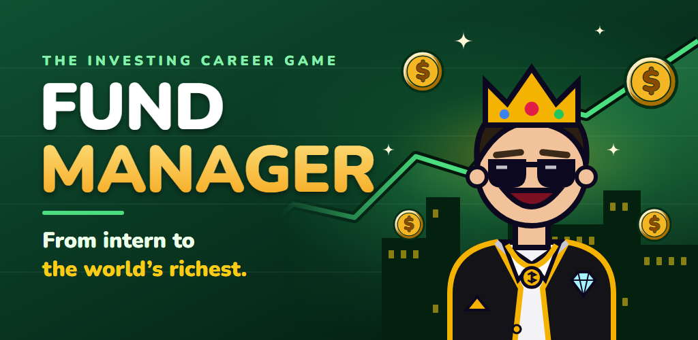
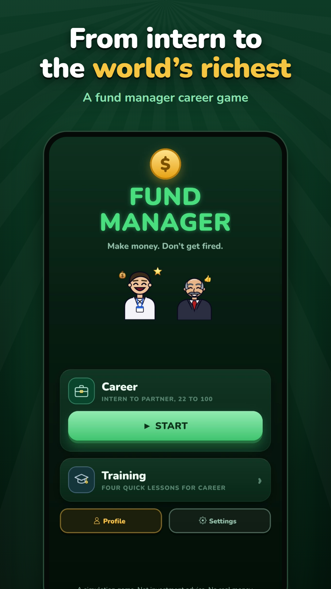
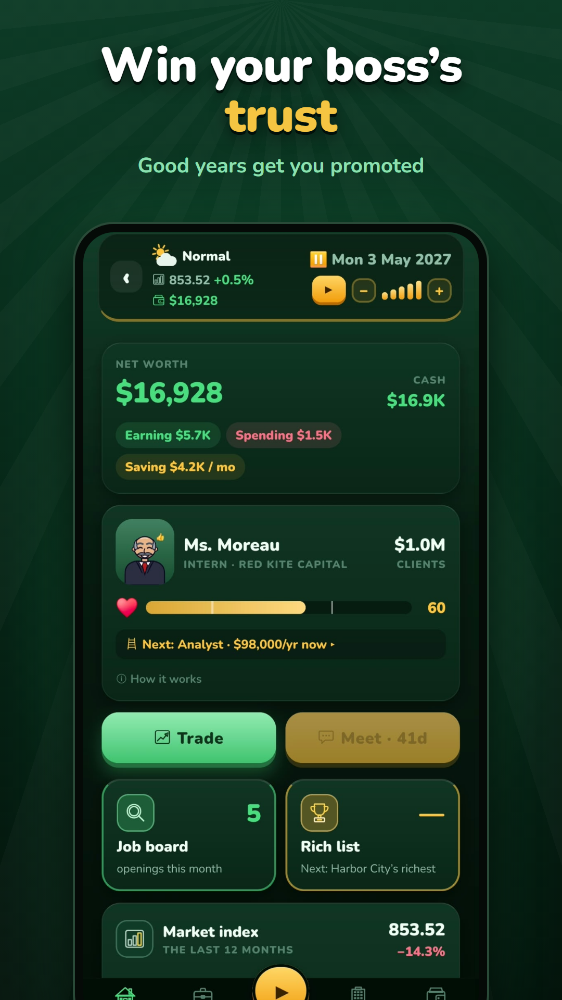
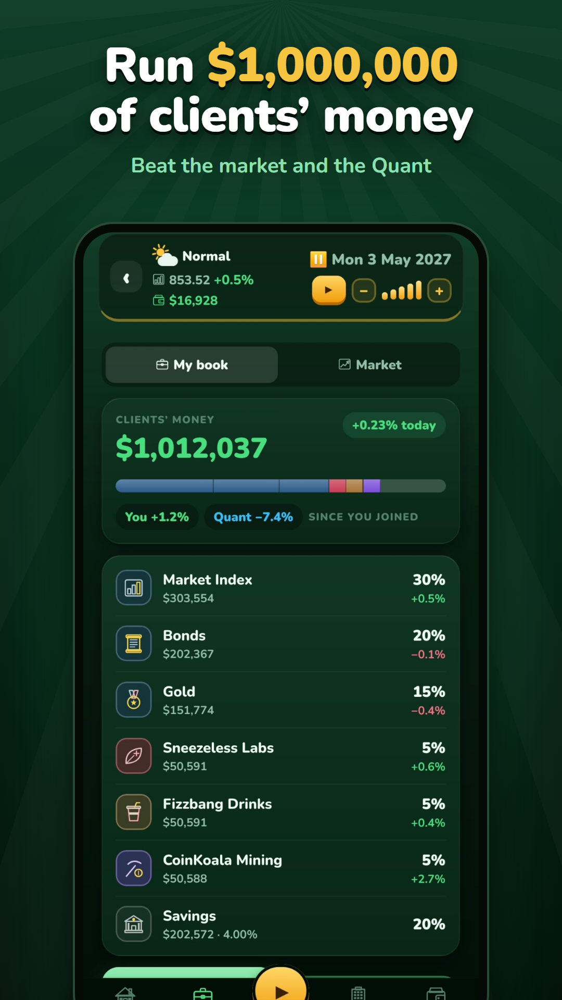
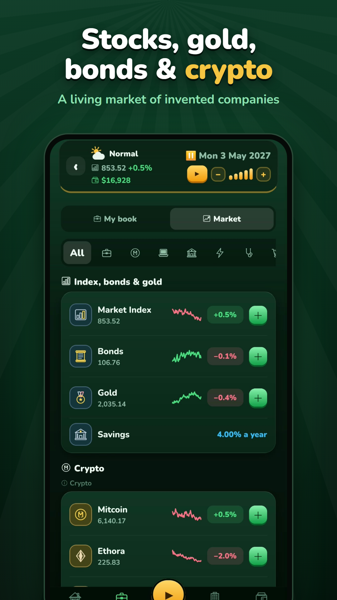

  

<h1 align="center">Fund Manager Game</h1>

<b>Make money. Don't get fired.</b> 
An offline investing career game for Android, built with Expo and React Native. 

  
  
  

---

## The game

**The goal: become the richest person in the world.**

You start at 22 as an intern at an investment firm with almost nothing. Climb from Intern to Partner, start your own fund, and grow your fortune until you top the city, country and world rich lists.

- **A living market.** Made-up companies in seven sectors, plus an index, bonds, gold and five crypto coins, move day by day on a running clock that you can pause and speed up. Booms, bear markets, crashes, rate moves, earnings days, takeovers and busts all happen.
- **The job.** You run the clients' money. You face meetings with real questions, client inflows and redemptions, analyst pitches, and calls from the risk desk. Your boss judges your own results, and the Quant, a rules-based computer portfolio, is the yardstick.
- **Your own money.** You choose a lifestyle, pay taxes, buy homes, cars, jets and an island, borrow on margin or take a mortgage, and manage status. Going bankrupt is the only game over.
- **Your own company.** You hire staff, pick a strategy and fees, market the fund, open offices, and watch for buyout offers.
- **Three difficulties.** Easy, Hard and Impossible. Reaching number one in the world is realistic on Easy, rare on Hard, and almost out of reach on Impossible, which plays like real life.
- **Training.** Four short lessons teach diversification, holding through drops, insurance and risk before the career starts.

Everything happens on the device. There are no accounts, ads, in-app purchases or data collection.

> A simulation game. Not investment advice. No real money.

> ## Screenshots

  
  
  
  

## Under the hood

- **A pure TypeScript engine** (`src/engine/`) with no React imports, so every rule can be tested in Node.
- **Deterministic and seeded.** All randomness goes through seeded mulberry32 streams, one per purpose, so the market never depends on what the player does.
- **A factor-model market.** Each stock moves with the market, its sector and its own noise, with jumps on top. Economic phases are hidden behind the economists' late read. Drifts are set so the expected returns hold, and statistical tests check that they do.
- **The Quant** is a mean-variance optimizer (FISTA projected gradient with a VaR bisection) that is checked against a brute-force grid.
- **Golden tests.** The original web mini-game runs in a Node `vm`, and the port reproduces its numbers bit for bit, including over 300 random scripted games.
- **Balance harness.** Scripted players (cash, index, Quant, reckless, founder) play whole careers, and the tests check that the outcomes rank sensibly in each difficulty.
- **Generated audio and art.** The 8-bit sound effects and the lounge-jazz music are rendered from code by Node scripts, so the same input gives the same file. The icons, splash and store art are SVG, rendered with headless Edge.
- **A save system you can trust.** The save is versioned and migrated through 20 versions. Writes are throttled, and an unreadable save is backed up before the game starts fresh.

## Stack

Expo SDK 58 · React Native · TypeScript · expo-router · zustand · react-native-svg · expo-audio · expo-haptics · AsyncStorage · Jest · EAS Build

## Credits

The game grew out of the *The Investor* mini-game in [calculus-meets-finance](https://github.com/ahmetozturk86/calculus-meets-finance). The font is Nunito (SIL Open Font License). The game was built with the help of AI ([Claude Code](https://claude.com/claude-code)). Every company, person and market in the game is invented.

A simulation game. Not investment advice. No real money.
