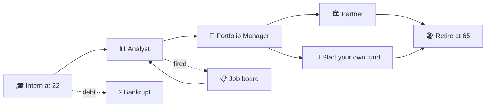

# 📈 Fund Manager Game

**Start as an intern. Retire as a legend, or go broke trying.**

A mobile investing game for Android and iOS. Manage other people's money, beat the market's bots, and build a career from age 22 to 65.

> 🔒 The source code is private. This page shows what the game is, how it's built, and where it's heading.

---

## 🎮 The idea

Most investing games are either spreadsheets or slot machines. Fund Manager Game sits in between: it has real market maths underneath, but it plays as a fast, emotional arcade game.

Markets have moods. A calm year rewards patience; a crisis punishes greed. Crashes hit without warning, and you get **8 seconds** to decide: sell, hold, or buy the dip. Throughout, a cold, calculating trading bot called **the Quant** runs the same money next to you. Beat it and you're promoted. Lose to it too often and you're fired.

*It's a simulation, not investment advice. No real money is ever involved.*

---

## 🕹️ Two ways to play

### ⚡ Arcade: quick contracts, big decisions

A 5-year contract takes a few minutes to play. You get $1M of a client's money and 3 hearts. Every losing year costs a heart.

| Mode | What it is |
|---|---|
| **Campaign** | 4 chapters, from *Intern Desk* to *Hedge Fund*. Each adds a new mechanic: gold, crash reactions, surprise months, insurance, tech stocks, client targets. |
| **Endless** | No end date. Cards come back and hearts heal now and then. How long can you last? |
| **Daily Challenge** | Everyone in the world plays the same markets today. Share your result as an emoji grid. |

The meta-game has **25 badges**, XP levels, unlockable outfits and three-star chapter ratings.

### 🏢 Career: a whole life in finance *(in progress)*

A Paradox-style sandbox on a live clock. Pause it, speed it up, and watch a career unfold day by day.

- **🌍 A living market:** 25 invented companies in seven sectors, with earnings days, central bank meetings, booms, crashes, bankruptcies, takeovers and new listings. The market never cares what you do.
- **👔 The job:** 14 firms, from small boutiques to elite houses. Your boss's trust rises and falls with your results. There are reviews twice a year, promotions, bonuses, and a job board with real interviews.
- **🎤 Meetings with consequences:** clients and bosses ask what happens next: the market, a sector, a stock. Three months later the market tells everyone whether you were right. Your track record becomes your reputation.
- **💰 Your own money:** spend your salary on a lifestyle, a car or a penthouse, invest the rest, and watch your status climb. Run out of cash and your debts catch up with you. Bankruptcy is the only true game over.
- **🏦 Your own company:** found a fund and run it as the boss. Hire analysts and portfolio managers, pick a strategy, set fees, run marketing campaigns, open offices, and one day sell it all.

---

## 📸 Screenshots

*Coming soon.*

---

## 🛠️ How it's built

| Area | Choice |
|---|---|
| App | Expo SDK 58 · React Native 0.88 · TypeScript |
| Navigation and state | expo-router · zustand, with versioned save migrations |
| Graphics and feel | react-native-svg · 8-bit sound effects · haptics · confetti |
| Testing | Jest · 20 test suites |

**Engineering highlights**

- **🧠 A pure game engine.** Every rule lives in plain TypeScript with no UI code, so the whole game can be simulated and tested without a phone.
- **🎯 Golden tests.** The arcade engine is checked number for number against the original web game, across 300 randomly played 5-year games. If one number drifts, the build fails.
- **📐 Real finance maths.** It has a factor model for daily stock returns, correlated sectors, crash and jump processes, and a portfolio optimiser that maximises growth under a value-at-risk limit (that's the Quant). Statistical tests check that every market phase averages what it should.
- **🎲 Deterministic randomness.** Seeded random streams mean a seed always replays the same market, whatever the player does. That's what makes the Daily Challenge fair.
- **📴 Offline first.** There are no accounts, ads, tracking or in-app purchases, and no personal data is collected.

---

## 🗺️ Roadmap

- [x] Arcade: campaign, endless and Daily Challenge
- [x] Badges, levels, outfits, sound, haptics and a tutorial
- [x] Career: living market, jobs and promotions, job board
- [x] Career: meetings, predictions and reputation
- [x] Career: personal finances, status and your own company
- [ ] Career: margin trading and loans
- [ ] Balancing and polish
- [ ] Release on **Google Play** and the **App Store**

---

## 🌱 Origin

The game grew out of the *Fund Manager* mini-game in my [calculus-meets-finance](https://github.com/ahmetozturk86/calculus-meets-finance) project: a small browser game about risk and return that turned into something much bigger.

**Made by [@ahmetozturk86](https://github.com/ahmetozturk86)**

⭐ Star this repo to follow the progress.

